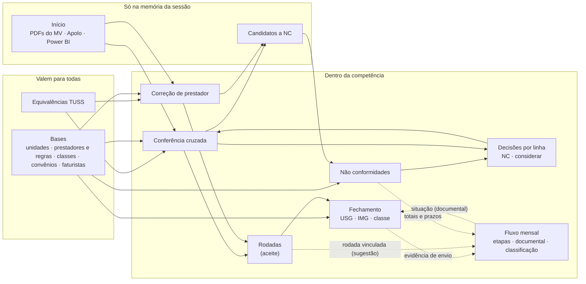

# Análise do fluxo: telas, conexões, sobreposições, gargalos e método

Versão analisada: v2.0.0-alpha.5 (30/10/2026). É uma análise, sem alteração de código.

## 1. Como as telas se conectam hoje

O caminho principal de um prestador:

1. Carregar os arquivos.
2. Conferir.
3. Tratar as divergências: validar equivalência, apontar NC, considerar no repasse ou corrigir no MV e conferir de novo.
4. Dar o aceite.
5. Fechar.
6. Copiar a prévia e enviar o e-mail.
7. Receber a NF e encaminhar ao Financeiro.

Essas etapas passam por **7 telas**: Início, Conferência, Equivalências, NCs, Rodadas, Fechamento e Fluxo.

## 2. Sobreposições que geram retrabalho

| # | O mesmo dado em dois lugares | Onde | Efeito | Proposta (fonte única) |
|---|---|---|---|---|
| S1 | **Produção de USG e classe** | Fluxo → Classificação (digitado à mão) × Fechamento → Produção e classe (calculado) | Digitar o que a ferramenta já calcula, com risco de divergir | O bloco do Fluxo passa a **mostrar o calculado** e só registra a conferência humana («conferido por…»), com ajuste manual justificado |
| S2 | **Lista de prestadores** | Fluxo → Modelo → «Prestadores deste fluxo» × Bases → regras (faixa USG, IMG, V3) | Manter duas listas; quem entra em uma não entra na outra | O controle documental do Fluxo **lê o cadastro de Bases** (USG = com faixa; IMG = recebe IMG; Curitiba = V3/unidade 5). A lista própria do Fluxo fica só para fluxos sem regra (PET, Sedação, 20%, 25%, Eco) |
| S3 | **Situação de envio** | O e-mail é preparado no Fechamento («Copiar prévia»), mas «relatório enviado» é marcado no Fluxo | Ir e voltar entre telas a cada prestador (~40 por mês) | No Fechamento, depois de copiar, o botão **«Marcar como enviado»** grava a data no controle documental do Fluxo (o mesmo dado, sem cópia) |
| S4 | **Aceite** | O resultado aparece na Conferência; o aceite fica em Rodadas | Trocar de tela para encerrar cada relatório | Botão **«Registrar aceite»** no próprio resultado da conferência (Rodadas continua como histórico) |
| S5 | **Etapas do Fluxo × o que a ferramenta já sabe** | Status das etapas digitado à mão (conferência, divergências, NCs, envio) | Atualizar o checklist do que já aconteceu na ferramenta | Mostrar o **status sugerido** em cada etapa (ex.: «12 de 14 prestadores com aceite»), com um clique para confirmar. Nada conclui sozinho, como já foi decidido |
| S6 | **Importações do Power BI** | Faturistas (Bases → Faturistas) e Convênios (Bases → Convênios), em botões separados, após carregar no Início | Três passos para um arquivo só | Uma ação **«Atualizar bases com o Power BI»** ao carregar o arquivo, com o resumo do que entrou (SOL-F9) |
| S7 | **Exportações espalhadas** | Cada aba exporta para «Downloads» com nomes próprios | Renomear e mover para a pasta da rede | SOL-F10: gravar na pasta da competência, com os nomes atuais |

Não é sobreposição, e deve continuar assim: Equivalências TUSS e o painel «Equivalências desta rodada» usam a mesma base e o mesmo motor. São duas portas para o mesmo dado.

## 3. Gargalos

### Do processo do repasse
1. **Equivalências não validadas (o maior).** Sem relação validada nada é conferido automaticamente: no relatório do prestador 15, as 67 de 67 linhas ficaram pendentes. Cada pendência vira análise manual.
   - Ação: validar em lote os títulos mais frequentes. Uma «sprint de validação» de 1 a 2 horas cobre a maior parte do volume, porque poucos títulos concentram a maioria dos laudos.
   - Indicador: % de linhas conferidas automaticamente, por competência.
2. **Ciclo de correção no MV.** Corrigir lá, extrair o PDF de novo e rodar de novo. Cada volta custa tempo, e a ferramenta já compara rodadas.
   - Ação: corrigir **em lote por prestador** (todas as divergências de uma vez) antes de extrair de novo.
   - Indicador: nº de rodadas até o aceite.
3. **Espera de terceiros:**
   - planilha do Apolo (2º dia útil);
   - relatórios das máquinas (Dra. Mariana, Dr. Paulo);
   - NFs dos prestadores.

   O Fluxo já marca «aguardando terceiros»; falta o **tempo de espera** como indicador.
4. **Dependência USG → classe → IMG.** O IMG só tem a classe certa quando todos os relatórios de USG estão aceitos. Um prestador de USG atrasado segura a classe de vários.
   - Ação: no Fechamento, listar «quem falta aceitar no USG para liberar a classe».
5. **Envio individual** (~40 prestadores): copiar, colar e anexar, um a um. SOL-F10 (PDF e prévia na pasta do médico) e S3 reduzem isso.

### Da ferramenta
6. **Recarregar arquivos a cada sessão.** PDFs e Apolo ficam só na memória (por privacidade), e os candidatos a NC também se perdem ao recarregar.
   - Ação: SOL-F10 «Carregar da pasta da competência» (um clique).
   - Ação: guardar os candidatos na competência, com a mesma retenção de 60 dias das NCs.
7. **Equipe de dois sem base compartilhada (risco alto de retrabalho).** Cada navegador tem a sua configuração, equivalências, NCs e fluxo, e o repasse e as NCs andam em paralelo. Hoje a troca é por backup manual: a validação feita por uma pessoa não aparece para a outra, e as duas podem validar ou registrar a mesma coisa.
   - Ação: **base compartilhada na pasta de rede** (extensão da SOL-F10). Um arquivo JSON por base, com revisão e «quem alterou», e aviso de conflito quando as duas mexerem no mesmo item.
8. **Dados que nascem em outro lugar:** CNPJ, regras e convênios vêm de planilhas suas. Já existem importadores; falta **reimportar com comparação** (o que mudou desde a última importação).

## 4. Fluxo-alvo (sem sobreposição)

| Etapa | Onde se faz | O que alimenta automaticamente |
|---|---|---|
| Carregar | Início («Carregar da pasta») | Painel da competência; Bases (Power BI) |
| Conferir e tratar | Conferência (validar equivalência, NC, considerar, **aceite**) | Rodadas, decisões, NCs, etapas do Fluxo (sugestão) |
| Registrar NC | NCs (natureza, responsável) | Fluxo (prazos), indicadores |
| Fechar | Fechamento (ajustes, prévia, **marcar enviado**) | Fluxo documental, classificação, planilhas na pasta |
| Acompanhar | Fluxo mensal (só o que é humano: NF, terceiros, observações) | Situação no Fechamento |

**Regra de projeto: cada dado tem um dono.** Quem digita é uma tela; as outras só leem.

| Dado | Dono |
|---|---|
| Valores, aceite e classe | Rodadas e Fechamento |
| Regras e lista de prestadores | Bases |
| Envio e NF | Fluxo (documental) |
| Natureza e responsável da NC | Não conformidades |

## 5. Metodologias ágeis

### Na operação do repasse
- **Kanban por prestador.** Colunas:
  1. a conferir;
  2. em correção;
  3. aguardando terceiros;
  4. com aceite;
  5. enviado;
  6. NF recebida;
  7. concluído.

  O Fechamento já tem essas situações; falta a visão em quadro.
  - **Limite de WIP em «em correção»** (ex.: até 5 prestadores), para fechar o ciclo antes de abrir outro.
- **Definição de Pronto (DoD) por prestador:**
  - aceite registrado;
  - divergências tratadas (NC ou «considerar»);
  - prévia enviada;
  - NF recebida e encaminhada.

  É exatamente a situação «Concluído».
- **PDCA mensal (retrospectiva de 30 minutos no fim da competência), com indicadores que a ferramenta já tem ou terá:**
  - % de linhas conferidas automaticamente (cobertura de equivalências);
  - nº de rodadas até o aceite, por prestador;
  - lead time por prestador (geração no MV → aceite → envio → NF);
  - NCs por natureza e por faturista (reincidência; base para o Qualiex);
  - dias de antecedência na entrega ao Financeiro (marcos do Fluxo).
- **Timebox:** sprint de validação de equivalências no início da competência, antes do 5º dia útil, aproveitando a espera pelo fechamento do USG.
- **Lean (os 7 desperdícios):** os maiores aqui são **espera** (terceiros), **retrabalho** (correção no MV, base não compartilhada) e **movimento** (trocar de tela, renomear e mover arquivos). As propostas S1–S7 atacam o movimento e o retrabalho.

### No desenvolvimento da ferramenta (como já vem sendo feito, formalizado)
- **Backlog priorizado** em `proximas-funcoes.md`, com MoSCoW (Must / Should / Could / Won't agora) ou RICE (alcance × impacto × confiança ÷ esforço).
- **Definição de Pronto para começar (DoR):** prévia visual aprovada, dúvidas respondidas e critérios de aceite escritos.
- **DoD de cada entrega:**
  - teste ponta a ponta com os arquivos reais;
  - regressão completa sem erro;
  - guia de uso atualizado;
  - versão nova no GitHub.
- **Incrementos pequenos:** uma SOL por versão, alinhada ao ciclo mensal. Entregar antes do início da competência para ser usada nela, e não no meio do fechamento.
- **Revisão de uso:** depois de cada competência real, anotar o que travou e virar item do backlog.

## 6. Ordem sugerida (do menor esforço ao maior impacto)

| Prioridade | Item | Esforço | Ganho |
|---|---|---|---|
| 1 | S4 aceite na conferência · S3 «marcar enviado» no Fechamento | baixo | menos troca de tela em todo prestador |
| 2 | S1 classificação do Fluxo lida do Fechamento · S2 documental lido de Bases | baixo/médio | fim de duas digitações duplicadas |
| 3 | Sprint de validação de equivalências (uso, não código) + indicador de cobertura | baixo | destrava a conferência automática |
| 4 | S5 status sugerido no Fluxo · candidatos a NC guardados na competência | médio | checklist sem redigitação; nada se perde ao recarregar |
| 5 | SOL-F10 pasta da competência + **base compartilhada para a equipe** | médio/alto | elimina downloads, renomeações e divergência entre as duas pessoas |
| 6 | Visão Kanban por prestador · indicadores de lead time e de rodadas até o aceite | médio | gestão do fluxo e retrospectiva mensal |
| 7 | SOL-F9 Power BI como base · SOL-F5 equivalências compostas | alto | próxima camada de automação |
